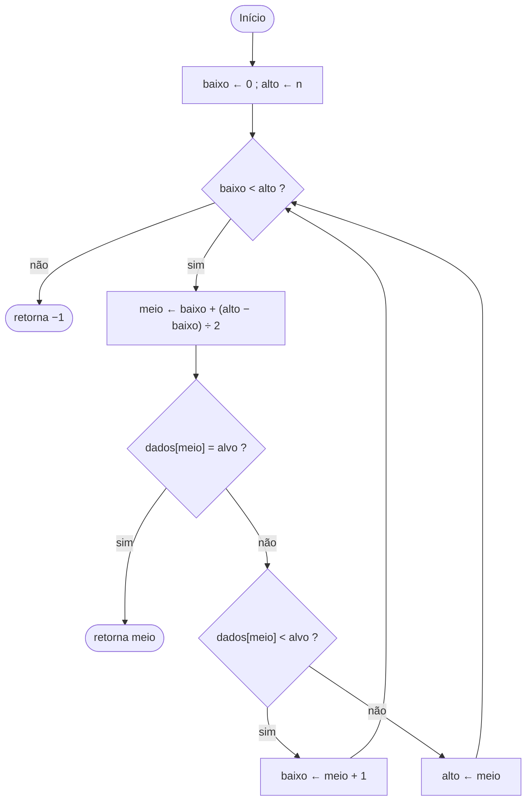

# Módulo 01 — Busca binária (Python × C × Java)

**Nível 1 — Fundamentos** · lógica, algoritmos, pseudocódigo, complexidade, debugging e testes.

Trilha: `Algoritmos → Python → C → Java → JavaScript → HTML → SQL → Sistemas → Redes → Aplicações → Cybersecurity`.
Este módulo é a ponte entre o primeiro e os três seguintes: o **mesmo algoritmo**, escrito em três linguagens
que resolvem problemas diferentes, para você ver o que muda (e o que não muda) de uma para a outra.

```bash
make test    # testes das três versões (C roda com AddressSanitizer + UBSan)
make demo    # saída didática das três versões
make bench   # benchmark comparativo
```

Requisitos: `python3`, `gcc`, `make`, `javac`/`java`. Sem dependências externas.
Testado com Python 3.13, gcc 13 e Java 21 (o teste de `010.0.0.1` da seção 8.4 exige Python ≥ 3.9.5).

---

## 1. Conceito

Procurar um valor numa sequência **ordenada** sem olhar todos os elementos: compare com o do meio e descarte
metade do que sobrou. É o jogo de "adivinhe o número de 1 a 100": 50? maior. 75? menor. 62? ...

A **pré-condição** é o ponto central do algoritmo: se a sequência não estiver ordenada, ele não avisa que errou,
ele só responde errado (veja a seção de segurança).

## 2. Pseudocódigo

```text
função BUSCA_BINARIA(dados, n, alvo):
    baixo ← 0
    alto  ← n                          // o alvo, se existir, está em dados[baixo .. alto-1]
    enquanto baixo < alto faça
        meio ← baixo + (alto − baixo) ÷ 2
        se dados[meio] = alvo então retorne meio
        senão se dados[meio] < alvo então baixo ← meio + 1
        senão alto ← meio
    retorne −1                         // intervalo vazio: não existe
```

## 3. Fluxograma



## 4. Por que funciona, e quanto custa

**Invariante do laço:** se o alvo está em `dados`, ele está em `dados[baixo .. alto-1]`.
Vale no início (`[0, n)`) e cada ramo a preserva: se `dados[meio] < alvo`, tudo até `meio` é menor que o alvo
(a sequência é ordenada), então `baixo = meio + 1` não perde nada; o ramo simétrico vale para `alto = meio`.

**Término:** o tamanho `alto − baixo` diminui a cada volta. Com `baixo = meio + 1` o novo tamanho é
`alto − meio − 1 < alto − baixo`; com `alto = meio`, é `meio − baixo < alto − baixo`.
Se você escrever `baixo = meio`, o tamanho pode não diminuir: **laço infinito**.

**Complexidade (Big O):** tempo `O(log n)`, espaço `O(1)` (iterativa) ou `O(log n)` de pilha (recursiva).
No pior caso são `⌊log₂ n⌋ + 1` comparações:

| n | busca linear (pior caso) | busca binária (pior caso) |
|---|---|---|
| 1.000 | 1.000 | 10 |
| 1.000.000 | 1.000.000 | 20 |
| 1.000.000.000 | 1.000.000.000 | 30 |

A conta tem um custo escondido: ordenar é `O(n log n)`. Compensa quando você **ordena uma vez e consulta muitas**.
Para consultas só de "existe ou não?", uma tabela hash (`set` em Python, `HashSet` em Java) é `O(1)` em média,
mas não guarda ordem e não responde "qual é o maior elemento menor que X?", que a busca binária responde.

## 5. Implementações

| Arquivo | O que tem |
|---|---|
| [`python/busca_binaria.py`](python/busca_binaria.py) | busca iterativa e recursiva, ponto médio, `montar_blocklist` / `ip_bloqueado` |
| [`python/test_busca_binaria.py`](python/test_busca_binaria.py) | `unittest`: casos de borda, exaustivo até 64 elementos, aleatório contra `bisect` |
| [`c/busca_binaria.[ch]`](c/busca_binaria.c) | biblioteca com `size_t` e `ptrdiff_t`, compilada e *linkada* com `demo.c`, `test_*.c` e `bench.c` |
| [`c/test_busca_binaria.c`](c/test_busca_binaria.c) | mesmos casos, aleatório contra busca linear; roda sob ASan + UBSan |
| [`java/BuscaBinaria.java`](java/BuscaBinaria.java) | busca iterativa e recursiva |
| [`java/BuscaBinariaTest.java`](java/BuscaBinariaTest.java) | mesmos casos, aleatório contra `Arrays.binarySearch` |

As três usam as mesmas convenções: intervalo **semiaberto** `[baixo, alto)`, retorno `-1` se não achou, e o mesmo
conjunto de testes. Em C o intervalo semiaberto é obrigatório na prática (veja o item 6).

## 6. Sintaxe lado a lado

```python
# Python — tipagem dinâmica, sem ponto e vírgula, blocos por indentação
baixo, alto = 0, len(dados)
while baixo < alto:
    meio = baixo + (alto - baixo) // 2
    if dados[meio] == alvo:
        return meio
    if dados[meio] < alvo:
        baixo = meio + 1
    else:
        alto = meio
return -1
```

```c
/* C — tipos explícitos; o array não sabe o próprio tamanho, por isso n é parâmetro */
size_t baixo = 0, alto = n;
while (baixo < alto) {
    size_t meio = baixo + (alto - baixo) / 2;
    if (dados[meio] == alvo) return (ptrdiff_t)meio;
    if (dados[meio] < alvo) baixo = meio + 1;
    else                    alto = meio;
}
return -1;
```

```java
// Java — tipos explícitos, dados.length vem com o array, tudo dentro de uma classe
int baixo = 0, alto = dados.length;
while (baixo < alto) {
    int meio = baixo + (alto - baixo) / 2;
    if (dados[meio] == alvo) return meio;
    if (dados[meio] < alvo) baixo = meio + 1;
    else                    alto = meio;
}
return -1;
```

## 7. Debugging: os erros clássicos

| Erro | Sintoma | Quem pega |
|---|---|---|
| `alto = n − 1` com intervalo semiaberto | nunca acha o último elemento | teste exaustivo (alvo = último) |
| `baixo = meio` (sem `+ 1`) | laço infinito | o teste trava; use *timeout* |
| `alto = meio − 1` com intervalo semiaberto | pula elementos | teste exaustivo |
| `alto = meio − 1` com `size_t` e `meio == 0` | `0 − 1` vira `SIZE_MAX` (C): leitura fora do array | ASan (`stack-buffer-underflow`); por isso o intervalo é semiaberto |
| `(baixo + alto) / 2` | índice negativo em `int` de 32 bits (Java), índice fora do intervalo (C) | teste do ponto médio (seção 8) |
| sequência não ordenada | resposta errada, sem erro | nada, só validar na carga |

Os testes deste módulo foram checados com **teste de mutação manual**: injetei erros, um por vez, em cópias
descartáveis do código (`alto = n − 1`, `baixo = meio` e `alto = meio − 1` nas três linguagens; o ponto médio ingênuo
em C e Java). Todos foram detectados; o laço infinito vira *timeout*, e em C o `alto = meio − 1` é acusado pelo ASan.
Duas mutações "sobreviveram", e as duas são **mutantes equivalentes** (mudam o código, não o comportamento):
trocar `<` por `<=` na comparação (o `==` já retornou antes, então os dois nunca diferem nesse ponto) e usar
`(baixo + alto) // 2` em Python (inteiros não estouram). Saber distinguir "teste fraco" de "mudança que não altera o
comportamento" faz parte de depurar com método.

Dica: para depurar o laço, imprima `(baixo, meio, alto)` a cada volta e confira o invariante à mão num array de 5 elementos.

## 8. Segurança

### 8.1 O bug do ponto médio

`(baixo + alto) / 2` parece inocente. Com `int` de 32 bits, `baixo + alto` pode passar de 2³¹ − 1.
Em 2006, Joshua Bloch descreveu publicamente que esse defeito estava na `Arrays.binarySearch` do JDK
("Nearly All Binary Searches and Mergesorts are Broken"): o código tinha anos de uso e só quebrava com
arrays de mais de ~1 bilhão de elementos (2³⁰), tamanho que na época ninguém testava.

| Linguagem | O que acontece com `baixo + alto` estourando | Rode |
|---|---|---|
| Python | nada: inteiros têm precisão arbitrária | `python3 python/busca_binaria.py` |
| Java | **wrap-around definido**: o resultado vira negativo e `dados[meio]` lança `ArrayIndexOutOfBoundsException` | `make demo` |
| C (`int`) | **comportamento indefinido**: o compilador pode assumir que isso nunca ocorre | |
| C (`unsigned`) | wrap-around definido, mas o ponto médio cai fora de `[baixo, alto]` | `make demo` |

Exemplo da saída do `make demo`: `ponto medio ingenuo (1500000000, 2000000000) -> -397483648` em Java,
contra `1750000000` com `baixo + (alto − baixo) / 2`.

Lição que vale para todo código de segurança: **o que é "impossível" no seu teste pequeno vira o vetor de ataque
quando o atacante controla o tamanho da entrada.** Overflow de inteiro é a origem de muitas corrupções de memória
em C (CWE-190, frequentemente seguido de CWE-125/787).

### 8.2 Memória (o que o C não faz por você)

`busca_binaria(const int *dados, size_t n, int alvo)` **confia em `n`**. Se quem chama passar um `n` maior que o
array real, a busca lê fora dos limites (CWE-125): o resultado é lixo ou vazamento de memória vizinha.
Python lança `IndexError` e Java lança `ArrayIndexOutOfBoundsException`. Em C você precisa de disciplina e de ferramentas:
é por isso que `make test-c` compila com `-fsanitize=address,undefined`, que transforma esses erros em falhas visíveis.

### 8.3 Pré-condição violada = falha silenciosa

Se a blocklist de IPs não estiver ordenada, `ip_bloqueado` responde `False` para IPs que deveriam ser bloqueados:
**falha aberta**. Verificar a ordenação a cada consulta custaria `O(n)` e anularia a vantagem. A defesa é garantir
a pré-condição **na carga** (`montar_blocklist` ordena e remove duplicatas) e testar.

### 8.4 Mais três pontos

* **Entrada inválida:** `ip_bloqueado` levanta `ValueError` em vez de adivinhar. O módulo `ipaddress` rejeita `010.0.0.1`,
  enquanto `inet_aton` em C lê isso como octal (8.0.0.1). Parsers que discordam geram *bypass* de blocklist e SSRF.
* **Complexidade algorítmica como superfície de ataque:** varrer uma lista de 10⁶ itens a cada requisição é `O(n)` por
  requisição, uma alavanca para negação de serviço. `O(log n)` tira essa alavanca do atacante.
* **Canal lateral:** o número de voltas e os acessos à memória dependem dos dados. Para segredos (comparar tokens, MACs)
  não use busca binária; use comparação em tempo constante.

## 9. Aplicação em Cybersecurity

* **Consulta de IOCs:** IPs, domínios e hashes de arquivos maliciosos de feeds de Threat Intelligence, guardados
  ordenados. `ip_bloqueado()` neste módulo é um exemplo funcional (IPv4 convertido em inteiro; endereços do bloco
  de documentação RFC 5737).
* **Logs ordenados por tempo (DFIR):** achar o início de uma janela de incidente em um log de gigabytes sem ler tudo.
  Com `seek()` você faz a busca binária direto no arquivo (é o que o comando `look` faz em arquivos ordenados).
* **Encontrar a origem de uma regressão:** `git bisect` é busca binária sobre o histórico de commits; serve para
  achar o commit que introduziu uma vulnerabilidade.
* **Visão do atacante, em laboratório:** técnicas de *blind injection* extraem dados caractere a caractere perguntando
  "o código deste caractere é maior que N?". Com busca binária são ~7 perguntas por caractere ASCII em vez de dezenas.
  A mitigação não está no algoritmo e sim no código vulnerável: *prepared statements*, limitação de taxa e monitoramento
  de padrões repetitivos (você verá isso nos módulos de SQL e Web Security).

## 10. Comparação entre as linguagens

Medido em `make bench`: 1.000.000 de consultas em um array de 1.000.000 de inteiros (4 vCPUs, uma execução; use como
**ordem de grandeza**, não como medida exata). O gerador de números pseudoaleatórios é o mesmo nas três e o *checksum*
(`achados=501055 soma=250500430170`) é idêntico, o que mostra que as três fazem o mesmo trabalho.

| | Python 3.13 | C (gcc 13, `-O2`) | Java 21 |
|---|---|---|---|
| Tempo, 10⁶ consultas | 3,79 s (própria) · 1,00 s (`bisect`) | 0,15 s | 0,22 s (1ª rodada, JIT aquecendo) · 0,19 s (3ª) |
| Memória do array | ≈ 36 MB | 4 MB | 4 MB |
| Paradigma / tipagem | multiparadigma, dinâmica | procedural, estática, fraca | orientado a objetos, estática, forte |
| Execução | interpretador (CPython) | código nativo | bytecode na JVM com compilação JIT |
| Gerenciamento de memória | contagem de referências + GC | manual (`malloc`/`free`) | *garbage collector* |
| Fora dos limites do array | `IndexError` | **comportamento indefinido** | `ArrayIndexOutOfBoundsException` |
| Overflow de inteiro | não existe (precisão arbitrária) | `int`: indefinido · `unsigned`: wrap | wrap-around definido |
| O array sabe o tamanho? | sim (`len`) | **não** (passa-se `n`) | sim (`.length`) |
| Quando usar | automação, análise de logs, protótipo | sistemas, desempenho, baixo nível, engenharia reversa | aplicações corporativas, servidores, Android |

Como ler a tabela:

* **Python vs. C (~25×):** cada elemento da lista é um objeto `int` (28 bytes) apontado por um ponteiro de 8 bytes,
  e cada volta do laço é interpretada. Em C é um `int` de 4 bytes, contíguo, e o laço vira poucas instruções.
  O `bisect` da biblioteca padrão é escrito em C: na prática, em Python você usaria ele. A parte "própria" serve
  para aprender e a prática é usar a biblioteca. (O tempo de ambos inclui o gerador pseudoaleatório rodando em Python.)
* **Java perto de C:** `int[]` também é contíguo, e o JIT compila o laço quente para código nativo. A 1ª rodada é
  mais lenta porque inclui o aquecimento. A JVM também paga a verificação de limites, que o C não faz.
* **Esses números não escolhem linguagem sozinhos.** Para um analista de SOC, 4 s ou 0,15 s para um milhão de consultas
  raramente importa; o que importa é escrever e validar a ferramenta em minutos. Para um motor de varredura em
  tempo real, importa. Para um parser exposto à internet, a segurança de memória pesa mais que a velocidade.

## 11. Projeto e exercícios

1. **Primeira e última ocorrência** (*lower bound* / *upper bound*): com duplicados, hoje a busca devolve "algum" índice.
   Implemente as duas variações e conte quantas vezes um valor aparece em `O(log n)`.
2. **Blocklist com faixas CIDR:** guarde faixas `[início, fim]` ordenadas e sem sobreposição, e descubra com uma busca
   binária se um IP cai em alguma delas.
3. **Busca em log por timestamp:** dado um arquivo de log ordenado por data, ache a primeira linha de uma janela de tempo
   usando `seek()` (cuidado com o limite de linha: a posição que você pula pode cair no meio de uma linha).
4. **Quebre de propósito (em laboratório):** em uma cópia, troque `alto = meio;` por `alto = meio - 1;` em `c/busca_binaria.c`
   e rode `make test-c`: o ASan acusa `stack-buffer-underflow`. Depois, chame `busca_binaria` com um `n` maior que o array
   real (`int d[8]` com `n = 9` dá `stack-buffer-overflow`; com `malloc(8 * sizeof(int))`, `heap-buffer-overflow`).
   Com `n = 1000` o ASan acusa no *heap*, mas **na pilha o acesso pode cair em outra memória válida e passar em silêncio**:
   ausência de erro de um detector não prova que o código é seguro.
5. **Quarta linguagem:** escreva a versão em JavaScript (próximo módulo da trilha) e compare: `Number` é *float* de 64 bits,
   então o que acontece com o ponto médio acima de 2⁵³?

## 12. Resumo da regra pedagógica

`Conceito (1) → Sintaxe (6) → Algoritmo (2–4) → Implementação (5) → Debugging (7) → Projeto (11) → Segurança (8) → Cybersecurity (9)`

O objetivo é escolher a linguagem pelo problema, não pelo hábito: o algoritmo é o mesmo, mas o que a linguagem
garante (ou deixa de garantir) para você muda o tipo de bug que você terá e o tamanho do estrago.
